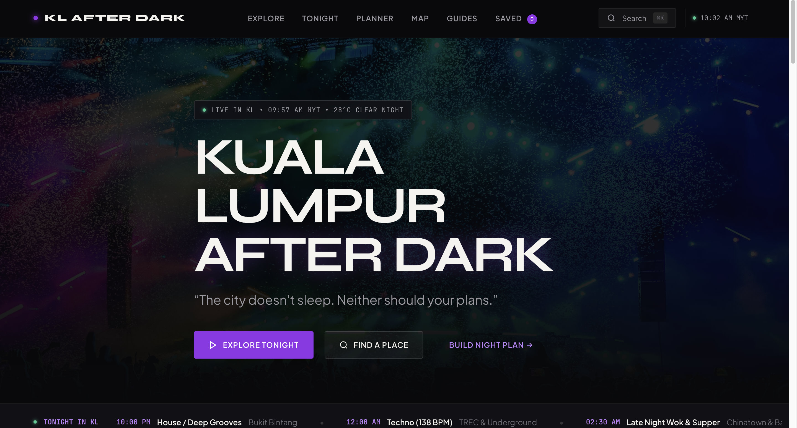
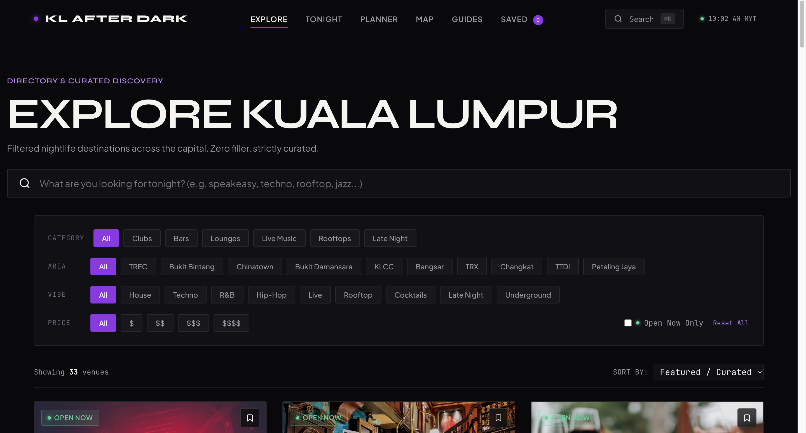
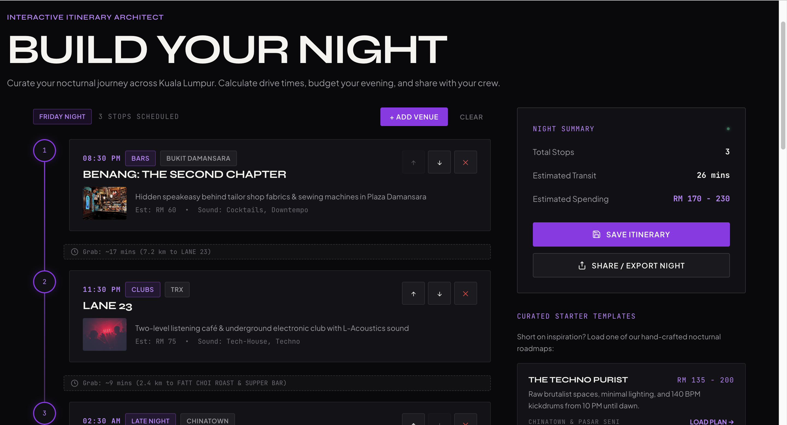
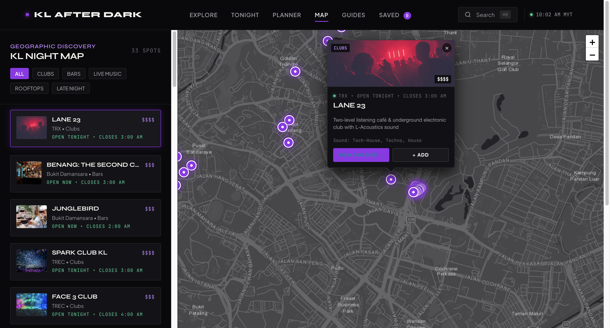
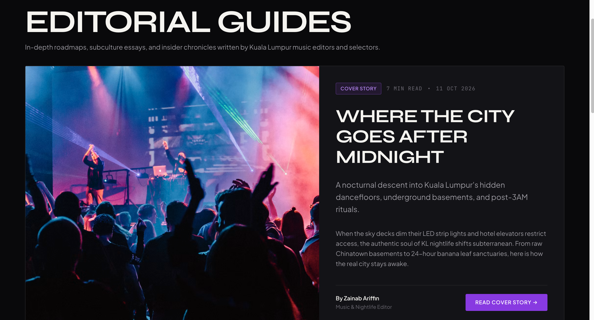

# 🌃 KUALA LUMPUR AFTER DARK (KLAD)

> *“The city doesn't sleep. Neither should your plans.”*

[](#)
[](#)
[](#)
[](#)
[](#)

---

**Kuala Lumpur After Dark** is a modern, editorial-first nightlife discovery web platform engineered for Greater Kuala Lumpur. Designed with an ultra-sleek dark aesthetic, KLAD strips away the noise of generic directories and ticket sales platforms to deliver curated, verified, and real-time night exploration—from underground techno basements and hidden speakeasies to rooftop cocktail lounges and 4:00 AM street supper rituals.

---

## 📸 Visual Showcase

### 1. Editorial Hero & Real-Time Nocturnal Ticker
The homepage features a live Kuala Lumpur time ticker (MYT / UTC+8), nocturnal status indicator (Twilight, Peak Rush, Deep Hours, After Hours), instant tonight marquee, and curated discovery entry points.

<p align="center">
  
</p>

---

### 2. Curated Directory & Multi-Facet Filtering
Search across **33 accurately verified nightlife destinations** spanning TREC KL, The Exchange TRX, Chinatown, Bukit Damansara, Bangsar, Petaling Jaya, and Changkat. Filter instantly by neighborhood, sound genre, vibe, price tier, and real-time open/closed status.

<p align="center">
  
</p>

---

### 3. Tonight in KL — Live Curated Nightlife Dashboard
A dynamic live schedule breaking the evening down into three nocturnal phases:
- **Phase 01: Warm Up & Sunset (6:00 PM – 10:00 PM)** — Rooftops, vinyl lounges, and aperitivos.
- **Phase 02: Peak Midnight (10:00 PM – 2:00 AM)** — Warehouse techno, mega clubs, and high-energy dancefloors.
- **Phase 03: Deep Hours & 24h Supper (2:00 AM – 5:00 AM)** — After-hours basements and legendary street food.

<p align="center">
  
</p>

---

### 4. Interactive Leaflet Nightlife Map
A custom Esri Dark Gray canvas with glowing, color-coded neon pulsing markers. Includes interactive sidebar synchronization, filter pills by category, click-to-center navigation, and seamless mobile bottom-sheet integration.

<p align="center">
  
</p>

---

### 5. Immersive Venue Detail & Field Notes
Rich profiles showcasing door policies, dress codes, resident DJ rosters, cocktail recommendations, Grab drop-off locations, nearest MRT/LRT stations, and curator insider tips.

<p align="center">
  
</p>

---

## ✦ Core Features & Pages

| Page | Route | Description |
| :--- | :--- | :--- |
| **Home** | `#/` | Editorial hero, live KL status clock, *"Tonight in KL"* preview, sound selector, trending spots, and neighborhood strips. |
| **Explore** | `#/explore` | Comprehensive 33-venue directory with multi-tag filtering (Category, Area, Vibe, Music, Price, Open Now) and sorting. |
| **Tonight** | `#/tonight` | Live event dashboard categorized by time brackets with set times, cover charges, and dress codes. |
| **Interactive Map** | `#/map` | Fullscreen dark map powered by Leaflet.js with custom pulsing markers and quick modal previews. |
| **Venue Detail** | `#/venue/:slug` | In-depth venue profile with high-res photo gallery, door policies, transit notes, and nearby spot suggestions. |
| **Night Planner** | `#/planner` | Drag-and-drop nocturnal itinerary builder with auto-calculated budgets, Grab transit estimates, and starter presets. |
| **Editorial Guides** | `#/guides` | Longform dispatches including *"The Electric Boulevard: Decoding TREC & Damansara"*, *"Chinatown Speakeasy Circuit"*, and *"The 4:00 AM Supper Guide"*. |
| **Guide Detail** | `#/guide/:slug` | Magazine article layout with pull-quotes, curator field rules, and direct links to featured venues. |
| **Personal Vault** | `#/saved` | LocalStorage-backed bookmarking for saved venues, read-later guides, and saved night itineraries. |
| **Manifesto** | `#/about` | Editorial philosophy, strict anti-payola independence policy, and community submission form. |

---

## 📍 Accurately Vetted Venues (33 Highlights)

The directory contains thoroughly researched, active venues across Greater Kuala Lumpur:
- **TREC KL (Electric Strip)**: The Iron Fairies, Dragonfly KL, Spark Club KL, Le Noir KL, Alibi KL, Kyo KL & Ren (Mandarin Oriental).
- **The Exchange TRX**: Lane 23 (Ultra-lounge & multi-genre dance club).
- **Bukit Damansara**: Benang The Second Chapter, JungleBird, Pahit (Changkat), BAC (Bar & Cocktail).
- **Chinatown & Petaling Street**: PS150, Coley Cocktail Bar (Bangsar), Botakliquor, fōno (Zon Seni Zhongshan).
- **Rooftops & Skylines**: Marini's on 57, Vertigo @ Banyan Tree, Troika Sky Dining (Fuego & Cocteleria).
- **Live Music & Underground**: No Black Tie (Changkat heritage), Bobo KL, Pitt Club KL (Jalan Kia Peng), Over & Above.
- **Late Night Supper**: Wong Ah Wah (Jalan Alor), TG's Nasi Kandar (Bukit Bintang), Restoran Devi's Corner (Bangsar).

---

## 🛠️ Technology Stack & Architecture

- **Frontend Core**: Vanilla JavaScript (ES6+ Modules), Semantic HTML5, Modular Vanilla CSS3.
- **Design System**:
  - **Colors**: Deep Midnight Charcoal (`#09090b`), Pure Off-White (`#f5f4f0`), Violet Accent (`#9333ea`), Neon Emerald (`#10b981`), Amber Gold (`#f59e0b`).
  - **Typography**: `Syne` (Headings & Display), `Plus Jakarta Sans` (Body & Navigation), `JetBrains Mono` (Metadata, Timestamps & Timers).
- **Mapping Engine**: Leaflet.js (v1.9.4 vendorized locally) + Esri Dark Gray Canvas & Reference Tiles (Fast, zero API token required, watermark-free).
- **Architecture**: Single Page Application (SPA) driven by a lightweight hash router (`#/`) with zero build step dependencies.
- **State & Storage**: Client-side `localStorage` caching for saved spots, planner itineraries, and search history.

---

## 🚀 Running Locally

### Option 1: Using XAMPP / Apache
1. Clone or place the repository inside your XAMPP web root:
   ```bash
   # On macOS
   /Applications/XAMPP/xamppfiles/htdocs/KLAD
   
   # On Windows
   C:\xampp\htdocs\KLAD
   ```
2. Start Apache via the XAMPP Control Panel.
3. Open your browser and navigate to:
   ```
   http://localhost/KLAD/
   ```

### Option 2: Using Node.js `serve` or Python Server
```bash
# Clone the repository
git clone https://github.com/haziqikhwan0606-arch/Kuala-Lumpur-After-Dark.git
cd Kuala-Lumpur-After-Dark

# Run with npx serve
npx serve -p 3000

# OR run with Python 3
python3 -m http.server 3000
```
Then visit [http://localhost:3000](http://localhost:3000) in your browser.

---

## 📂 Project Structure

```
KLAD/
├── index.html                   # Master single-page app container & SEO meta
├── README.md                    # Product documentation & screenshot showcase
├── .gitignore                   # Excludes OS artifacts & large recordings
├── css/
│   ├── base.css                 # Reset, typography, utility classes
│   ├── variables.css            # Dark mode color tokens, glassmorphism vars
│   ├── components.css           # Venue cards, badges, modals, toast system
│   ├── pages.css                # Layout styles for all 10 views
│   └── responsive.css           # Mobile navigation, bottom sheets & breakpoints
├── js/
│   ├── app.js                   # Application lifecycle & global initialization
│   ├── router.js                # Client-side hash routing engine
│   ├── data/
│   │   ├── venues.js            # 33 verified venues with coordinates & metadata
│   │   └── guides.js            # Editorial articles and nightlife dispatches
│   ├── components/
│   │   ├── navbar.js            # Header, live KL clock, mobile drawer
│   │   ├── venue-card.js        # Reusable card component with quick-actions
│   │   ├── search-modal.js      # Global quick-search (Cmd/Ctrl + K)
│   │   └── toast.js             # Notification feedback system
│   ├── pages/                   # Modular controllers for each route
│   │   ├── home.js
│   │   ├── explore.js
│   │   ├── tonight.js
│   │   ├── map.js
│   │   ├── venue-detail.js
│   │   ├── planner.js
│   │   ├── guides.js
│   │   ├── guide-detail.js
│   │   ├── saved.js
│   │   └── about.js
│   └── utils/
│       ├── formatters.js        # Currency, time, category formatting helpers
│       └── storage.js           # LocalStorage wrapper for bookmarks & planner
├── vendor/
│   └── leaflet/                 # Locally bundled Leaflet map library & styles
└── assets/
    └── images/
        └── README/              # High-resolution screenshots showcasing the app
```

---

## 🌙 Author & Manifesto

Created with passion for Kuala Lumpur's nocturnal culture.  
Curated independently. No sponsored rankings. Pure nocturnal exploration.

**Repository**: [https://github.com/haziqikhwan0606-arch/Kuala-Lumpur-After-Dark](https://github.com/haziqikhwan0606-arch/Kuala-Lumpur-After-Dark)
